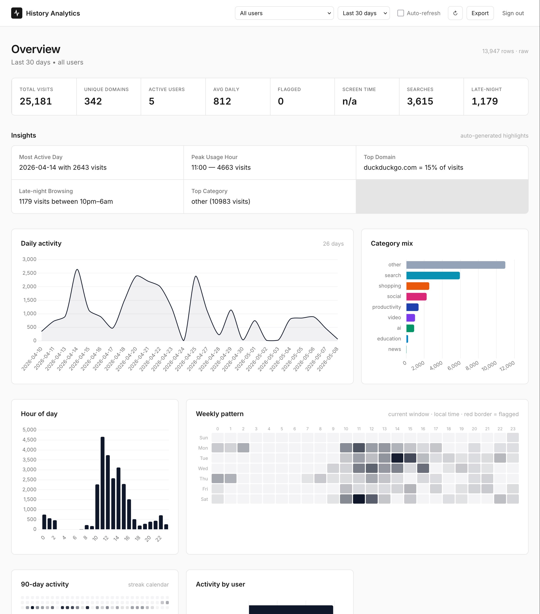

# PocketHistory

A self-hosted family browser history dashboard backed by PocketBase. Chrome and Firefox extensions upload individual web visits from each family member's browser. Parents can see the family's data; children can see only their own. The dashboard shows domains, searches, flagged sites, time patterns, and recent visits.



## What it records

Each extension reads browser history, including history that existed before installation. It uploads one record per browser visit with a stable visit ID. PocketBase rejects duplicate IDs, derives domain, category, flagged status, and search terms from the URL, then builds daily, hourly, user, and search summaries every ten minutes. An import can take several sync cycles; the popup shows whether it is complete.

Browser history does **not** measure how long a page was viewed. Screen time and dwell time are shown only if another source supplies duration. Incognito/private sessions and history already deleted from the browser are unavailable.

## Set up PocketBase

Use PocketBase 0.39 or newer. Back up an existing `pb_data` directory before upgrading this project.

1. Copy `pb_hooks/` and `pb_migrations/` beside `pb_data/`, then start PocketBase. The migrations add the `users.role` field and update existing history collections. On an existing installation, the second migration pauses rollups and clears two old summary tables; run the backfill below before relying on charts.
2. In the PocketBase admin UI, import [`pb_schema.json`](pb_schema.json) through **Settings → Import collections**. Restart PocketBase so category seeding runs.
3. In **Settings → Application**, enable batch requests and set **Max requests** to at least 25 for full-size batches. PocketBase disables this endpoint by default.
4. Create one `users` account per family member. Set each parent's `role` to `parent` in the admin UI. Leave children's role as `child`. Only a PocketBase superuser can assign or change a parent role. The superuser account is for administration and backfill, not the family dashboard login.
5. If there are existing `history` records, run the backfill below after the schema is imported. This rebuilds summaries and resumes the ten-minute rollup job.

The collection rules allow a parent to read all family history and summaries. A child can read rows matching their account email. Extensions must sign in to upload. The server assigns the email from the account and calculates classifications; values sent by a client cannot override them.

## Install extensions

Load `pocketbase-history-chrome/` or `pocketbase-history-firefox/` as an unpacked extension. Open its popup and enter your PocketBase HTTPS URL plus that family member's `users` email and password. The password is used to obtain a PocketBase auth token and is not saved. The browser will ask for permission to connect to that PocketBase origin. The popup then lets you start a sync and reports the last success or error.

Each browser installation has its own device ID. First sync begins a historical import while new visits continue to sync. The extensions upload up to 25 visits per request via PocketBase's `/api/batch` endpoint. Failed uploads keep their pending range for retry, and already saved visits are counted only once. If the token expires, sign in again in the popup. For local testing, HTTP is accepted only for `localhost` or `127.0.0.1`.

The extensions do not capture Safari.

## Run the dashboard

Serve `dashboard/` as static files. For example:

```bash
python3 -m http.server 8765 --directory dashboard
```

Enter the PocketBase URL on the sign-in screen if it is hosted elsewhere. The URL is saved in that browser. Dashboard libraries, CSS, and fonts are local files; loading the dashboard does not fetch them from a CDN. If you change utility classes in the dashboard, rebuild CSS with:

```bash
npm ci --prefix dashboard
npm run build:css --prefix dashboard
```

Short date ranges read individual visits. Long ranges use rollups. If a short range contains over 50,000 visits, the dashboard asks for a narrower range instead of silently dropping rows. Dates and hours use the visit device's local offset when available; old records without an offset use UTC. Flagged and search charts depend on the rollup job having run.

## Rebuild summaries

Install the script dependency and run the rebuild with a PocketBase superuser:

```bash
npm ci --prefix scripts
POCKETBASE_URL=https://your-pocketbase.example \
PB_ADMIN_EMAIL=admin@example.com PB_ADMIN_PASSWORD='your-password' \
node scripts/backfill_rollups.js
```

The script pauses live rollups, scans history in stable ID order, rebuilds all four summary collections, moves the rollup cursor to its starting cutoff, and resumes live rollups after a successful finish. If it fails, rollups remain paused and a rerun starts the rebuild again. Distinct visits to the same URL remain distinct. `UPDATE_HISTORY=0` leaves raw enrichment fields untouched.

Existing rows uploaded by older extension versions may contain cumulative `visit_count` values rather than individual visits. Backfill can preserve their counts but cannot reconstruct the exact visit times. New uploads use one row per visit.

## Categories and flagged sites

`domain_categories` contains domain classification rules. Add or edit rows in the PocketBase admin UI. `exact` matches only one host; `suffix` also matches subdomains. DB rows take priority over the bundled fallback list. Changes affect new visits immediately. Rebuild summaries after changing historical classifications; old raw rows need separate re-enrichment if you want their stored categories changed.

Flagged visits can send an email to the first PocketBase superuser, once per domain per UTC day. Configure PocketBase mail settings for delivery. The dashboard always shows flagged rows regardless of email delivery.

## Operations and privacy

A superuser can trigger a rollup immediately with `POST /api/history/rollup`. The job normally runs every ten minutes and processes at most 5,000 new rows per tick, carrying its cursor forward to the last processed row. It waits one minute before processing newly created rows.

The dashboard makes requests only to the PocketBase URL you configure. The extensions request access only to that origin. Raw URLs and search terms can contain sensitive information, so restrict access to PocketBase, use HTTPS, and keep regular backups of `pb_data`.

## Repository layout

| Path | Purpose |
|---|---|
| `pocketbase-history-chrome/`, `pocketbase-history-firefox/` | Browser extensions |
| `dashboard/` | Static dashboard and bundled assets |
| `pb_schema.json` | PocketBase collections and access rules |
| `pb_migrations/` | Family roles and upgrade changes |
| `pb_hooks/` | Enrichment, notifications, and rollups |
| `scripts/backfill_rollups.js` | Summary rebuild for existing data |
| `tests/` | Focused sync behavior tests |

## License

See [LICENSE](LICENSE).
